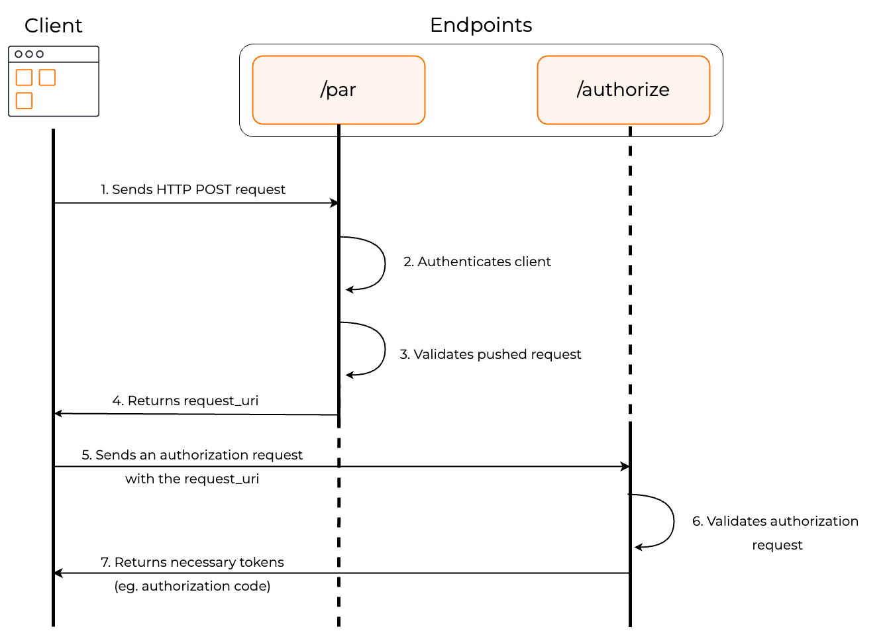

Generally, when a user logs in to a web application using a user agent, such as a web browser, an OAuth 2.0 authorization request is initiated from the front-channel. This introduces two major challenges,

- The authorization payload is sent through query strings in a URL. Therefore, the authorization server cannot guarantee the integrity of the authorization payload.

- Complex authorization requests can sometimes be too large for browsers to process.

The PAR specification defines the `/par` endpoint in an authorization server to mitigate these issues.

During a PAR initiated login, first, the back-channel sends the authorization payload directly to the `/par` endpoint of the authorization server.  The `/par` endpoint, in response, returns a reference to the authorization payload called the `request_uri`.

After this interaction, the usual OAuth flow takes place in the front-channel. But, instead of including the complete authorization payload in the URL, the new authorization request contains only the client ID of the application and the `request_uri`.

Therefore, using PAR with an OAuth authorization request,

- ensures integrity of the request is protected.
- ensures confidentiality of the request.
- enables complex requests to be passed without browser limitations.
- avoids leakage of query strings to third-party sites and web server logs.

## How does it work?

The diagram below illustrates the PAR authorization flow.

<Variants><Edition only="cloud"></Edition><Edition only="self-hosted"></Edition></Variants>

1. The client makes a POST request to the `/par` endpoint along with all the parameters required for authorization.

2. The authorization server authenticates the client.

3. The endpoint validates the pushed authorization request.

4. If the validation is successful, the endpoint returns a response containing the `request_uri`, which functions as the reference to the authorization payload.

5. The client makes an authorization request to the authorization endpoint with the client ID and the request_uri.

6. The `/authorize` endpoint validates the request.

7. If the validation is successful, the client receives the authorization code (or the access token based on the chosen grant type).