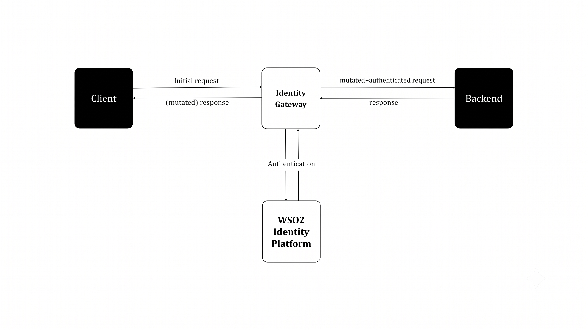
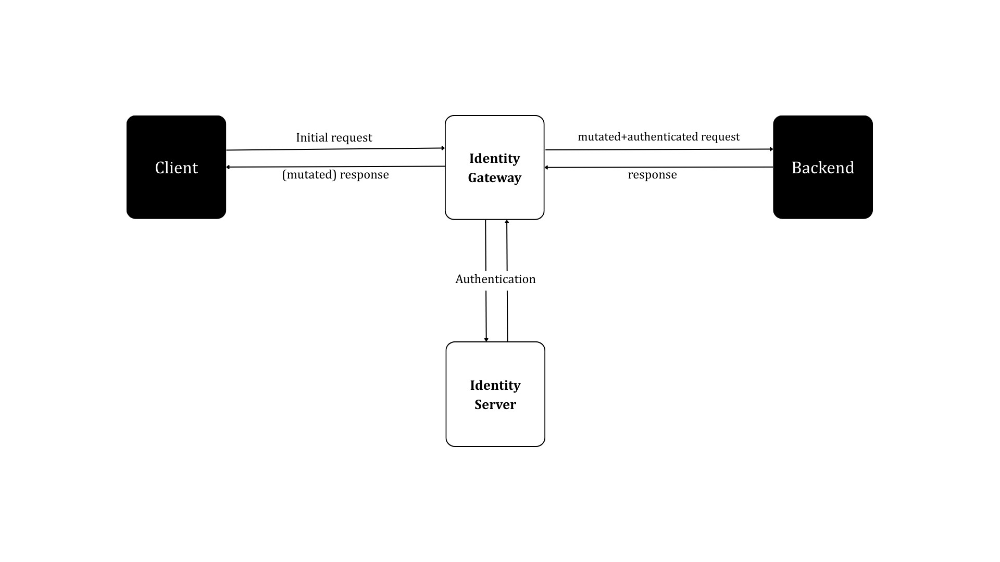

# Use {edition.productName} with identity gateways

An identity gateway sits in front of your application and enforces authentication and authorization before requests reach your application.

Identity gateways protect your application by,

- intercepting incoming traffic.

- verifying the user’s identity (using protocols like OAuth2 or OpenID Connect).

- enforcing fine-grained access rules.

- forwarding the request to the application only if it meets the security requirements.

<Variants>

<Edition only="cloud">

By connecting {edition.productName} with identity gateways, you can centralize user management and apply consistent access control across your entire application ecosystem.

</Edition>

<Edition only="self-hosted">

By connecting WSO2 Identity Server with identity gateways, you can centralize user management and apply consistent access control across your entire application ecosystem.

</Edition>

</Variants>

This section explains how to connect {edition.productName} with the following identity gateways.

- [OAuth2 Proxy](./protect-apps-with-oauth2proxy.mdx)

- [Oathkeeper](./protect-apps-with-oathkeeper.mdx)

- [Mod Auth OpenIDC](./protect-apps-with-mod-auth-openidc.mdx)
